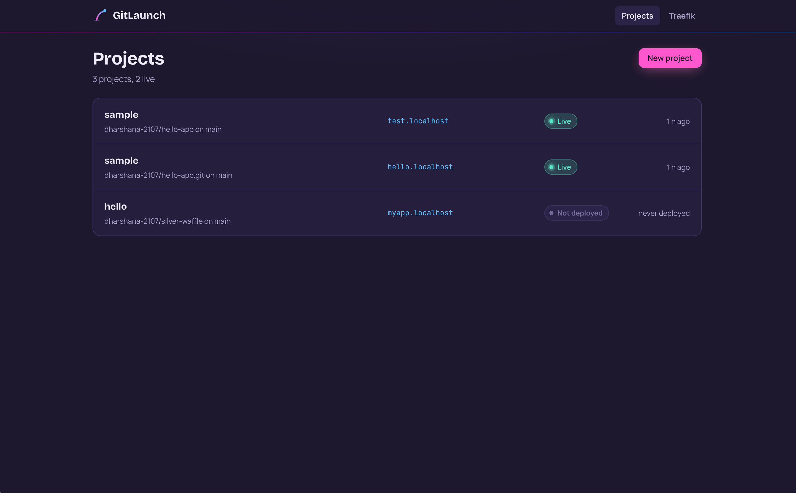
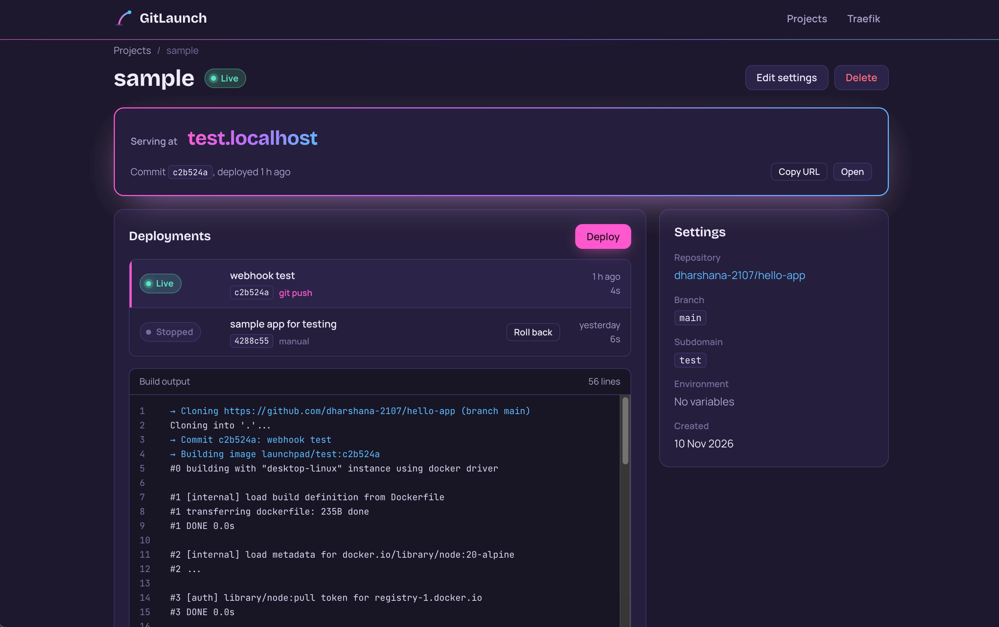
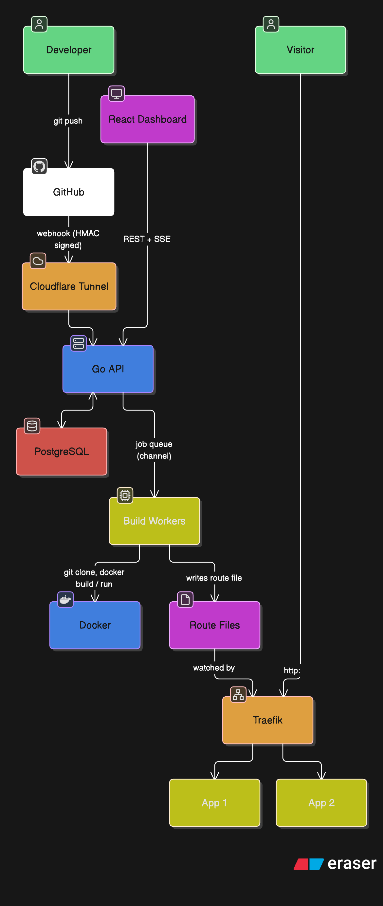

# GitLaunch

A self-hosted deployment platform which points at a GitHub repo with a **Dockerfile**, and every `git push` builds the image, health-checks it and switches traffic to it at `http://<subdomain>.localhost`, with zero downtime, live build logs and one-click rollback.





**Features**

- **Deploy from GitHub:** create a project from a public repo, click Deploy or just `git push` (signed GitHub webhooks)
- **Live build logs:** streamed to the browser while the build runs (Server-Sent Events), with replay and resume
- **Zero-downtime releases:** the new container is health-checked before traffic moves; a broken version never goes live
- **Instant rollback:** any earlier version, from its stored image, in seconds, no rebuild
- **Env vars:** saved per project; changing them restarts the app with no rebuild
- **App logs:** what the running app prints, in the dashboard
- **Guard rails:** per-app memory/CPU/process limits, a cap on running apps, old images cleaned up, only the signed webhook reachable from the internet

## Architecture



**A deploy, step by step**

1. **Queue:** the API records a `queued` deployment and puts its id on a Go channel, then answers `202 Accepted`. A partial unique index allows only one unfinished deployment per project.
2. **Build:** a worker goroutine clones the branch (`--depth 1`), reads the commit, and runs `docker build`. The image is tagged with the commit SHA. Every output line is numbered, stored in Postgres and pushed to the browser over SSE.
3. **Start:** the new container starts **next to** the old one, with memory, CPU and process limits, on the `launchpad-apps` network.
4. **Health check:** the API calls the app until it answers HTTP. If it crashes or never answers, it is removed, and the old version keeps serving.
5. **Switch:** the API rewrites the project's Traefik route file (written to a temp file, then renamed, which is atomic). Traefik reloads in milliseconds.
6. **Drain and clean up:** after 3 seconds the old container is removed, and images beyond the newest 5 are deleted.

## Design decisions

| Decision | Why | Trade-off |
| --- | --- | --- |
| Go standard library (`net/http`, `database/sql` + pgx) | Few dependencies, every line explainable | More code than a framework or ORM |
| Builds in background goroutines, queue = buffered channel | Requests return instantly; no extra service | Queue lives in memory: unfinished builds are marked failed on restart |
| SSE for logs, not WebSockets | Logs flow one way; plain HTTP; browser reconnects with `Last-Event-ID` | Not suitable for two-way features (a web terminal would need WebSockets) |
| Database constraints for races (unique subdomain, one active and one live deployment per project) | Correct even when two requests arrive together | Errors must be mapped from Postgres codes |
| API writes Traefik route files (not Docker labels) | Traffic moves only after the health check; Traefik needs no Docker socket | The platform manages routing itself |
| Image tag = commit SHA, images kept | Rollback in seconds, no rebuild; every image traceable | Disk use: bounded by keeping the newest 5 |
| HMAC-verified webhooks, constant-time compare | Only GitHub can trigger deploys; no timing leak | One shared secret for all repos (a GitHub App would scale better) |
| `git` and `docker` as commands behind a `Runner` interface | No heavy SDKs; worker logic tested with fakes, no Docker in CI | Parses CLI output |

What would change for production: HTTPS and a real wildcard domain, a GitHub App instead of per-repo webhooks, login and per-user projects, a durable queue (Redis/SQS), isolated builds (rootless BuildKit or a VM per build), several machines (or Kubernetes).

## Tech stack

| Part | Tech |
| --- | --- |
| API | Go 1.22+ (standard library `net/http`, `database/sql` + `pgx` driver) |
| Database | PostgreSQL 16 (schema migrations embedded in the binary) |
| Dashboard | React 18 + TypeScript + Vite |
| Builds and apps | Git, Docker |
| Routing | Traefik v3 (file provider) |
| Live logs | Server-Sent Events (`EventSource`) |
| Deploy on push | GitHub webhooks, Cloudflare quick tunnel |
| CI | GitHub Actions: gofmt, go vet, go test -race, TypeScript build |

## Run it on a Mac

### 1. Install the tools (once)

```bash
brew install go node git
```

Install **Docker Desktop** from docker.com and start it.

### 2. Start Postgres and Traefik

```bash
docker compose up -d          # from the repo root
docker compose ps             # postgres "healthy", traefik "Up"
```

### 3. Start the API (terminal 1)

```bash
cd api
go run ./cmd/server           # must run from api/: it writes routes to ../data/routes
```

### 4. Start the dashboard (terminal 2)

```bash
cd web
npm install                   # first time only
npm run dev
```

Open http://localhost:5173

### 5. Deploy something

1. **New project** → that repo's URL, branch `main`, subdomain name → **Deploy**.
2. When it says **live**, open http://<sub-domain>.localhost.

### 6. Deploy on git push (optional)

```bash
brew install cloudflared
export WEBHOOK_SECRET=<any long random text>       
cloudflared tunnel --url http://localhost:8080  
```

In the repo on GitHub: **Settings → Webhooks → Add webhook**. Payload URL `https://….trycloudflare.com/api/webhooks/github`, content type `application/json`, the same secret, "Just the push event". Push a commit and watch it deploy. Only the webhook path is reachable through the tunnel; everything else answers 403.

### Tests

```bash
cd api && go test -race ./...
```

## Settings (environment variables of the API)

| Variable | Default | Meaning |
| --- | --- | --- |
| `PORT` | `8080` | API port |
| `DATABASE_URL` | local Postgres from docker compose | Postgres connection |
| `BUILD_WORKERS` | `2` | builds that may run at the same time |
| `APPS_DOMAIN` | `localhost` | apps are served at `<subdomain>.<APPS_DOMAIN>` |
| `ROUTES_DIR` | `../data/routes` | where route files for Traefik are written |
| `WEBHOOK_SECRET` | (empty = off) | shared secret for GitHub webhooks |
| `KEEP_IMAGES` | `5` | images kept per project for rollback |
| `MAX_LIVE_APPS` | `10` | most apps that may run at once |

Each app gets `PORT` (default 3000, override with a `PORT` env var on the project) plus its own env vars.

## API

| Method | Path | Success | Errors |
| --- | --- | --- | --- |
| GET | `/api/health` | 200 | |
| GET | `/api/config` | 200 `{webhooksEnabled, webhookPath}` | |
| GET | `/api/projects` | 200 list | |
| POST | `/api/projects` | 201 project | 400 bad JSON, 409 subdomain taken, 422 invalid fields |
| GET | `/api/projects/{id}` | 200 project with env vars | 400, 404 |
| PUT | `/api/projects/{id}` | 200 project | 400, 404, 409, 422 |
| DELETE | `/api/projects/{id}` | 204 (also removes its containers, route and images) | 400, 404 |
| POST | `/api/projects/{id}/deployments` | 202 queued deployment | 404, 409 one already running or app limit, 503 queue full |
| GET | `/api/projects/{id}/deployments` | 200 latest 20 | |
| GET | `/api/projects/{id}/app-logs?tail=200` | 200 `{container, lines}` | 404 not live |
| GET | `/api/deployments/{id}` | 200 deployment | 404 |
| GET | `/api/deployments/{id}/events` | SSE: `log`, `status`, `done` | 404 |
| POST | `/api/deployments/{id}/redeploy` | 202 rollback (older) or restart (live) | 404, 409 no image / one running |
| POST | `/api/webhooks/github` | 202 queued/deferred, 200 to `ping` | 401 bad signature, 503 webhooks off |

## Project layout

```
api/
  cmd/server/main.go           start-up, wiring, middleware, graceful shutdown
  internal/config/             settings from environment variables
  internal/db/                 connection pool, embedded migrations, Postgres error codes
  internal/httpx/              JSON helpers
  internal/project/            projects: model, validation, store, handlers
  internal/deployment/         queue + workers, git/docker runner, SSE broker, runtime
                               (containers, health check, routes), webhook, rollback, tests
web/src/                       React dashboard (pages, components, api.ts)
samples/hello-app/             tiny Node app with a Dockerfile
docs/                          study guides per phase, demo script, interview cheat sheet
docker-compose.yml             Postgres + Traefik
.github/workflows/ci.yml       CI
```

## Troubleshooting

| Problem | Fix |
| --- | --- |
| `ping database: connection refused` | Start Docker Desktop and `docker compose up -d`; check `docker compose ps` shows `127.0.0.1:5432->5432` |
| `port 5432 already in use` | Another Postgres runs: stop it, or change the port in `docker-compose.yml` and `DATABASE_URL` |
| `port 80 already in use` | Change `"80:80"` to `"8000:80"`, set `VITE_APPS_PORT=8000` in `web/.env`, open `http://hello.localhost:8000` |
| Build fails at `git clone` | Repo must be public, branch must exist |
| "no Dockerfile" | The Dockerfile must be in the repo root |
| "app did not become healthy" | The app must listen on `PORT` (default 3000); the build log shows its last output |
| `network launchpad-apps not found` | `docker compose up -d` creates it |
| `hello.localhost` shows 404 after a deploy | `docker compose restart traefik` |
| Webhook 401 | Secret mismatch. "Redeliver" re-sends the OLD signature: push a new commit to test |
| Webhook times out | `cloudflared` stopped or its address changed: restart it, update the Payload URL |
| "limit of running apps is reached" | Delete a project, or raise `MAX_LIVE_APPS` |
| Start from an empty database | `docker compose down -v` (deletes all data) |
